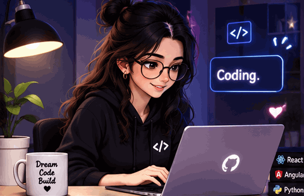

# 👋 Hi, I'm Aradhana Valva

<h3 align="center">
  Frontend-Focused Full Stack Developer | React.js | Angular | Node.js | Laravel
</h3>

  Building scalable, responsive and user-friendly web applications.

  <a href="https://www.linkedin.com/in/aradhana-valva-2205a8134/">LinkedIn</a> •
  <a href="mailto:aaradhana.valva@gmail.com">Email</a> •
  <a href="https://www.instagram.com/_a_for_aaru_/">Instagram</a>

---

## 👩‍💻 About Me

- 💼 Frontend-Focused Full Stack Developer with 6+ years of experience.
- ⚛️ Specialized in React.js, Angular and JavaScript.
- 🛠️ Experienced in Node.js, Laravel, PHP and REST API integration.
- 🎨 Passionate about clean UI, reusable components and responsive design.
- 🤖 Exploring AI-assisted development tools and workflows.
- 🐍 Currently learning Python.
- 🤝 Open to exciting development opportunities and collaborations.

 

---

## 💻 Tech Stack

### 🎨 Frontend Development
- React.js, Redux, Angular, AngularJS
- JavaScript (ES6+), TypeScript
- HTML5, CSS3, Bootstrap, Tailwind CSS
- Material UI

### ⚙️ Backend Development
- Node.js, PHP, Laravel
- REST APIs, GraphQL

### 🗄️ Database
- MongoDB, MySQL

### 🛠️ Tools & Technologies
- Git, GitHub, VS Code, Postman
- GitHub Copilot, ChatGPT, OpenAI Codex, Claude

---

## 📚 Currently Learning

- 🐍 Python
- 🔍 Python fundamentals and problem-solving
- 🚀 Exploring backend development with Python

---

## 🚀 Technology Badges

  
  
  
  
  
  
  
  
  

---

## 📊 GitHub Statistics

  
  

---

## 🐍 Contribution Activity

  

---

<h3 align="center">
  💜 Building. Learning. Improving. 🚀
</h3>

  Thanks for visiting my profile!

